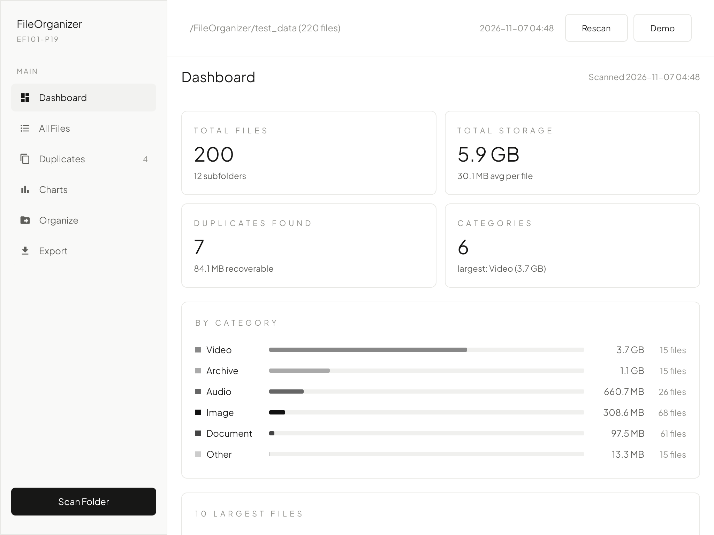
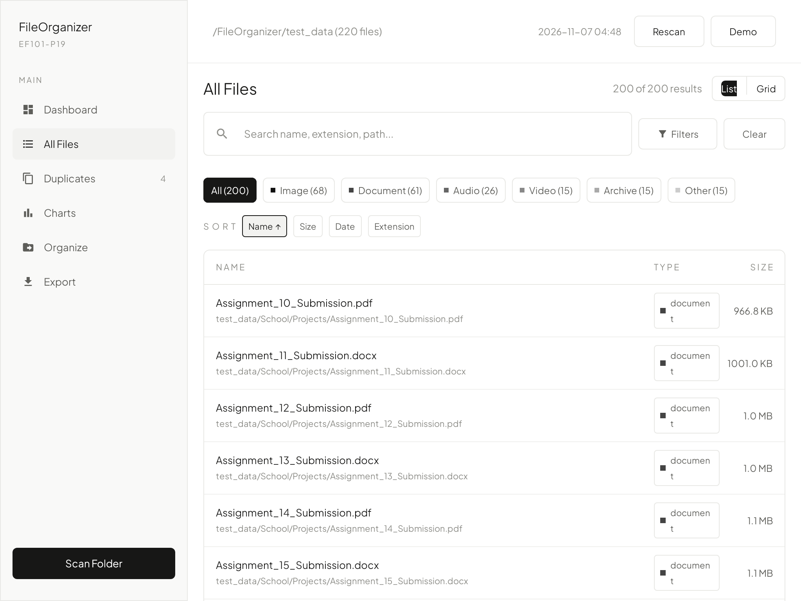
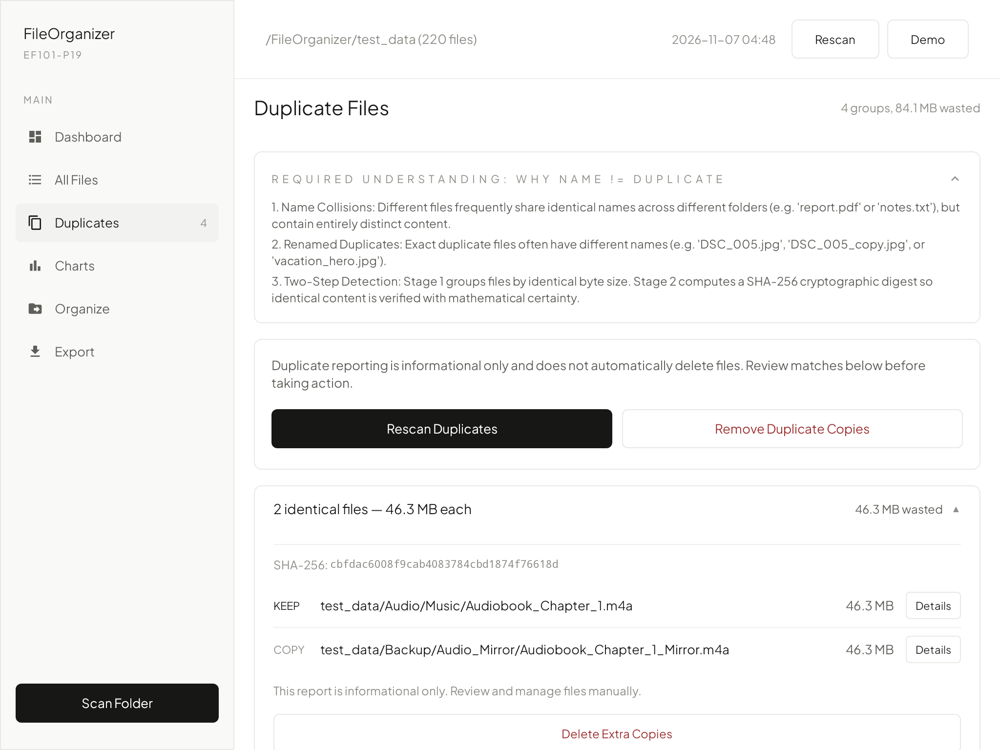
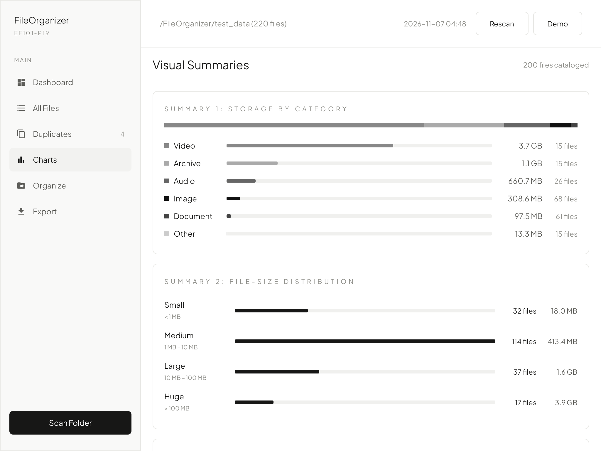
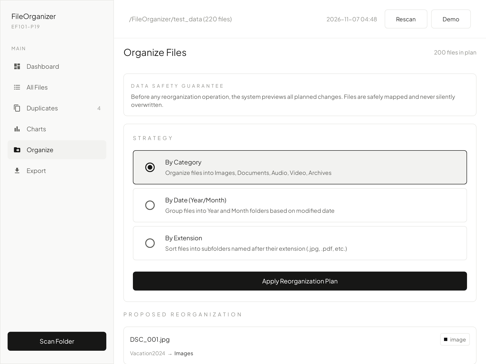
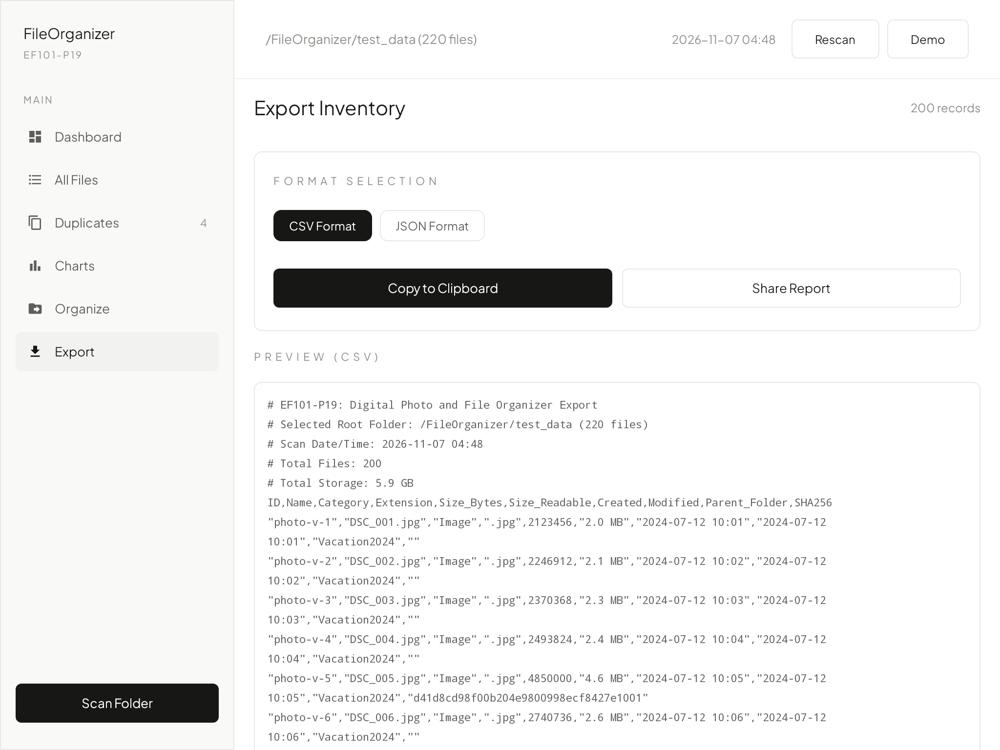

# Digital Photo & File Organizer — App Screenshots & Report Guide

All 6 real application screenshots have been captured and saved both in this **Artifacts** folder and in `/public/screenshots/` in your project file explorer:

1. `screenshot_1_dashboard.png` — **Dashboard Screen** (goes under **3.1 `main.py`**)
2. `screenshot_2_all_files.png` — **All Files Screen** (goes under **3.2 `scanner.py`**)
3. `screenshot_3_duplicates.png` — **Duplicate Files Screen** (goes under **3.3 `duplicate.py`**)
4. `screenshot_4_charts.png` — **Visual Summaries / Charts Screen** (goes under **3.8 `charts.py`**)
5. `screenshot_5_organize.png` — **Organize Files Screen** (goes under **3.5 `organizer.py`**)
6. `screenshot_6_export.png` — **Export Inventory Screen** (goes under **3.6 `exporter.py`**)

---

## 1. Dashboard Screen (`screenshot_1_dashboard.png`)

* **Where to put it:** At the bottom of **Section 3.1 (`main.py`)**.
* **Caption / How it works:**
  > When you open the app and scan a folder (or load the `test_data` demo folder), the **Dashboard** gives you an instant overview of your storage. At the top, four summary cards display **Total Files (200 across 12 subfolders)**, **Total Storage (5.9 GB)**, **Duplicates Found (7 files / 84.1 MB recoverable)**, and **Categories (6)**. Below that, the **By Category** progress bars show how much space each file type uses, followed by the **10 Largest Files** list.

---

## 2. All Files Screen (`screenshot_2_all_files.png`)

* **Where to put it:** At the bottom of **Section 3.2 (`scanner.py`)**.
* **Caption / How it works:**
  > Clicking **All Files** in the sidebar displays every file found by `scanner.py`. You can search by file name, extension, or path in the search bar, filter by category pills (`All`, `Image`, `Document`, `Audio`, `Video`, `Archive`, `Other`), sort by `Name`, `Size`, `Date`, or `Extension`, and toggle between **List** view and **Grid** (thumbnail) view in the top-right corner.

---

## 3. Duplicate Files Screen (`screenshot_3_duplicates.png`)

* **Where to put it:** At the bottom of **Section 3.3 (`duplicate.py`)**.
* **Caption / How it works:**
  > The **Duplicates** tab shows every twin group found using our two-step check (byte size + SHA-256 digital fingerprint). Each group displays its shared SHA-256 hash, how much storage space is wasted, which original file is marked **KEEP**, and which extra copies are marked **COPY**, along with safe options to review details or remove/quarantine extra copies.

---

## 4. Visual Summaries / Charts Screen (`screenshot_4_charts.png`)

* **Where to put it:** At the bottom of **Section 3.8 (`charts.py`)**.
* **Caption / How it works:**
  > The **Charts** tab turns the database numbers into visual breakdowns: **Summary 1 (Storage by Category)** with a stacked bar and per-category progress bars, and **Summary 2 (File-Size Distribution)** grouping files into `Small (< 1 MB)`, `Medium (1 MB – 10 MB)`, `Large (10 MB – 100 MB)`, and `Huge (> 100 MB)`.

---

## 5. Organize Files Screen (`screenshot_5_organize.png`)

* **Where to put it:** At the bottom of **Section 3.5 (`organizer.py`)**.
* **Caption / How it works:**
  > The **Organize** tab lets you pick a sorting rule (**By Category**, **By Date (Year/Month)**, or **By Extension**) and shows a **Proposed Reorganization** dry-run preview (for example, `DSC_001.jpg` moving from `Vacation2024` ➔ `Images`) before any file is touched.

---

## 6. Export Inventory Screen (`screenshot_6_export.png`)

* **Where to put it:** At the bottom of **Section 3.6 (`exporter.py`)**.
* **Caption / How it works:**
  > The **Export** tab lets you switch between **CSV Format** (for Excel/Google Sheets) and **JSON Format**, shows a live preview of the generated report with summary headers and SHA-256 hashes, and lets you copy or save the report in one click.
